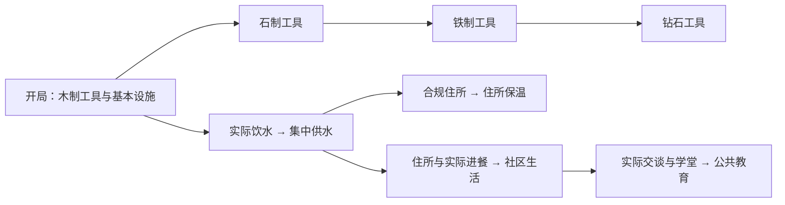

# 0030：从生活问题推进殖民地发展

日期：2026-10-08。状态：1.12.0 首轮实现。用户要求自主完善玩法，科技契合实际发展，压力/忠诚展开社会关系，并从基础生活引入水源和温度。

## 必须成立的结果

- 打印、基本设施与原有工具路线继续可用。打印不要求住房，新需求不能让旧工人升级后立即停工。
- 科技解锁可观察的能力，前置和生活实践由服务端真实状态证明；玩家/维度归属隔离。研究遵守实际库存、触及、预约、优先度和原子扣料。
- 生活行为使用实际路线、距离、视线、权限和已加载区块；没有物资/对象时允许继续工作，失败路线必须让出工人，不吞持料或改签任务。
- 人际关系与对玩家的忠诚分别记录。关系只由实际相处形成，不凭离线时间或 UI 按键捏造，卸载不删除关系。
- 忠诚可由生活改善和实际持续供养积累；日常关系不扣忠诚。反复降低/恢复同一品质、同日反复进餐或读档不能刷奖励。危机下降和特殊指令出口遵守 0024。
- 旧数据迁移，未知或坏数据原样保留并停止相关写入。

## 首轮路线

| 研究 | 生活前置 | 材料 | 有效时间 | 实际能力 |
| --- | --- | --- | --- | --- |
| 集中供水 | 一名存活的本殖民地工人实际喝过水 | 铜锭 4、橡木木板 8 | 20 秒 | 取水站、提高饮水品质 |
| 住所保温 | 集中供水、合规住所 | 白色羊毛 8、橡木木板 16 | 30 秒 | 实际房间内温度向 20°C 缓和 65% |
| 社区生活 | 集中供水、合规住所、工人实际进餐 | 面包 6、橡木木板 12 | 30 秒 | 聚会点、交谈和关系 |
| 公共教育 | 社区生活、至少 10 秒实际相处、自有学堂 | 纸 12、书 3 | 40 秒 | 学堂速度 ×1.5，与现场教师加速相乘 |

工具三项保留材料和耗时；分支有独立完成状态，不用工具等级冒充全部科技。界面显示前置、缺少的实践、材料、耗时、能力和真实进度。材料不足的任务可等补料。第一人称原版合成台可预制新设施，设施与工人生产仍需对应科技才能运行。

## 实现选择，可随实测调整

饮水值 0–100，初始满值，约三游戏日消耗一轮，工作消耗 ×1.25；低于 65 寻水，低于 20 增加缺水压力，低于 15 工作速度 ×0.8。同时检查导航范围内可用取水站与八格范围裸露静止水源，按距离尝试；每轮最多规划 12 个候选，路线 400 tick 超时后让出 200 tick。原版天然水源按可再生语义保留，喝水不删除源方块。取水站六面须至少一面直接邻接真实水源，并满足归属、科技和触及。暂不含有限水箱、管线、净化耗材或污染。

局部温度考虑群系、维度、露天昼夜/雨水、浸水和真实热源；营火、燃烧炉子、岩浆在四格附近提供可见热量，墙体阻隔。每 100 tick 最多检查 405 个已加载方块，不进行全世界传热。基础舒适区 8–32°C，环境抗性拓宽范围；寒热压力分别展示，挖掘、建造、制造/研究速度最多因此降至 75%。住所保温只影响实际房间内部，不能远程庇护。温度暂不增加伤害，原生危险保留。

社交值 0–100，初始 80，每日消耗 20；低于 20 累积孤独压力，低于 50 尝试自有聚会点，单次最多 240 tick、重试间隔 600 tick。至少两名本殖民地工人实际在场、可见、没有运输持料且未执行其他工作/课程，才记录相处。一人同一秒最多参与一次对话，双方有效时间相同，最多 32 个关系。相处每 2000 tick 增加一单位亲近度，最高 100；5/20/60 对应熟人/朋友/挚友。交谈恢复社交需求，亲近者提供较多压力恢复；目击亲近者被处决的冲击最多增加 50%，保留既有单事件 99 压力保护，不直接扣忠诚。艺术、战斗和其他关系事件另行推进。

首次生活改善按历史最高品质记账，修复反复剥夺/恢复刷忠诚。持续供养需要实际进餐：食物品质至少 1、已喝水、饮水 ≥40、休息 ≥40% 且有合规住所，每游戏日最多一次、默认 3 忠诚；检查点按 `gameTime` 保存，回拨时间不重复奖励。没有进餐事件，空闲、聊天和时间流逝不会产生这份收益。这是 0024 生活改善和可积累恩义的具体形式。

需求修正是当下生理状态，不替代 18 条属性的独立效果映射。饮水/社交/寒热压力及供养奖励独立配置。

生活取用站位还须能避开上方遮挡：在真实三格触及范围内尝试对角与较远的安全站位，复用有效路线；不能仅试容器四个紧邻格，让贴墙食物仓库饿死工人。

## 保存和交付

科技 schema 1→2 保留工具进度，新增节点集合须满足前置；旧进度不白送生活科技。任务 schema 6 的研究 recipe 字段支持新编号，进度和 FIFO 不变。工作网络协议 5，双方须升级到相同版本。

人物新增独立 `ColonyNeeds` schema 1，保存饮水、社交、温度、饮水品质、真实饮食计数、供养检查点和关系；缺字段的旧工人安全初始化，坏/未来数据导致人物只读并原样保留。专业 ColonyState、偏好和设施 Living 版本不变。

验证见 [1.12.0](../validation/1.12.0.md)。客户端、长期经营、原存档及多人体验独立验收。

下一轮优先接入工人熔炼/烹饪，让铜、铁和好食物能由殖民地生产，再推进有限蓄水、泵送与净化，使自建水路和布局影响吞吐。随后实现有成本/参与者的音乐、仪式、关系事件和环境地图。热扩散、季节、生态循环需独立性能预算，不在本轮冒充完成。
