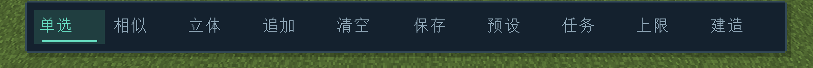

# 战略界面 UI 交接说明

这份文件供其他 AI 接手界面设计和客户端实现。先读配套的 [任务提示词](ai-task-prompt.md)，再按本文件查代码。当前交付只有文档，下面的新底栏、二级菜单和中键循环尚未实现。

## 基线和目标

- 记录日期：2026-10-06；代码基线：1.6.1，提交 `b8d894e81935c57476e3a95b9e1f8c4767859900`。接手时先检查 Git 状态，保留其后的改动。
- Minecraft 1.20.1、Forge 47.4.0、Java 17；使用原生 `Screen` / `GuiGraphics`，遵守 [AGENTS.md](../../AGENTS.md)。
- 玩法核心：玩家亲手搭建预设，再在战略视角规划，由殖民地工人施工。场景是主要操作区，UI 应方便寻找入口并减少遮挡。
- 本次优先完成底栏、二级菜单、选择模式提示及相应路由。已有建造目录、预设库和生产界面复用现有功能，外观可逐步统一。

当前底栏参考图（用户提供，只展示旧底栏）：



## 用户已经确定的需求

| 部位 | 必须实现的行为 |
| --- | --- |
| 底栏 | 移除单选、相似、立体、追加和清空五个按钮；不把它们换成另一排常驻按钮 |
| 左侧 | “投影”入口，点开二级菜单，包含保存投影、放置投影和建造目录 |
| 最右侧 | “殖民地”入口，点开二级菜单及殖民地概况，保留人物、科研等入口 |
| 殖民地按钮旁 | 常驻“挖掘”和“清扫”，选区确认后可直接下单 |
| 选择工具 | 中键单击按“单选 → 相似 → 立体 → 追加”循环 |
| 追加 | 沿用上次的单选或相似工具，保留既有选区；不能固定为追加单个方块 |
| 清空 | 场景内右键单击清空，右键拖动仍平移镜头 |
| 镜头 | 默认只锁角度，平移和缩放可用；解锁后中键拖动旋转 |
| 遮挡 | 空选区、空闲操作说明不常驻；建造目录继续使用窄侧栏 |

底栏结构示意，尺寸和样式交给设计者调整：

```text
┌─────────────────────── 场景 ─────────────────────────┐
│                                             锁 / ? / 退出 │
│                                                         │
│                                                         │
│ [投影菜单：按需展开]            [殖民地概况和菜单：按需展开] │
│ [投影 ▴]        中间保留场景        [挖掘] [清扫] [殖民地 ▴] │
└─────────────────────────────────────────────────────────┘
```

建议保留右上角的锁定、帮助和退出入口；底部使用左右两组短面板，中间留空。菜单向上展开，不在闲置时显示整块背景。模式切换后可短暂提示“相似”或“追加 · 相似”，有选区时在现有选区摘要里显示模式，无须新增常驻模式按钮。

以下是建议的二级菜单组织，用户确定的三项投影功能及人物/科研入口必须保留，其他项可以调整排序：

| 投影菜单 | 殖民地菜单 |
| --- | --- |
| 保存投影：保存当前已确认的真实方块选区为预设 | 概况：当前维度已加载工人、进行中的工程/任务、科技阶段 |
| 放置投影：打开预设库选择预设并放置 | 人物：查看已有工人资料，可复用打印工人入口 |
| 建造目录：打开现有方块目录 | 任务：进度、阻塞原因、优先度、暂停及取消 |
| 相似上限：迁入此菜单或帮助设置，默认 64 | 合成、科研：打开已有工作站页面 |
|  | 工程：打开现有施工管理页面 |

## 当前代码结构

以下均为现有文件。链接以仓库根目录为基准，新增结构另见下一节。

```text
src/main/java/dev/colony/camera/client/
├─ screen/
│  ├─ StrategyScreen.java        输入优先级、面板互斥、动作分发
│  ├─ StrategyHud.java           底栏/提示/帮助的绘制
│  ├─ StrategyHudLayout.java     纯 Java 矩形布局和命中
│  ├─ ProjectionPanel.java      保存、预设库、本地投影、工程管理
│  ├─ ProjectionPanelLayout.java
│  ├─ BuildPanel.java           建造目录和放置草稿条
│  ├─ BuildPanelLayout.java
│  └─ SelectionLimitPanel.java  相似选中数量设置
├─ work/
│  ├─ WorkPanel.java            任务 / 合成 / 科技三页
│  ├─ WorkPanelLayout.java      纯 Java 生产面板布局
│  ├─ ColonyWorkScreen.java     第一人称工作站界面
│  └─ ColonyWorkClient.java     工人/任务/配方/科技快照和客户端意图
├─ construction/
│  └─ ConstructionClient.java   工程/打印核心快照和客户端意图
├─ planning/
│  └─ ProjectionController.java 本地投影及建造放置草稿
├─ selection/
│  ├─ SelectionState.java      纯 Java 选区集合、模式、追加开关
│  └─ BlockSelectionController.java 世界适配和未完成选择的生命周期
├─ camera/
│  └─ StrategyCameraController.java 镜头和选择的会话控制
└─ input/
   ├─ CameraKeyMappings.java    按键绑定
   └─ CameraClientEvents.java   Forge 输入和渲染桥接
```

| 优先阅读 | 现状与修改入口 |
| --- | --- |
| [StrategyHudLayout.java](../../src/main/java/dev/colony/camera/client/screen/StrategyHudLayout.java) | `Action` 有十个底栏动作和三个右上角动作；`controls()`、`actionAt()`、`blocksWorld()`共享同一组 `Rect`。目前 `dock()` 是居中的整条工具栏 |
| [StrategyHud.java](../../src/main/java/dev/colony/camera/client/screen/StrategyHud.java) | `resize()`、`render()`、`drawControl()`、`blocksWorld()`；目前只有帮助展开状态，没有投影/殖民地二级菜单 |
| [StrategyScreen.java](../../src/main/java/dev/colony/camera/client/screen/StrategyScreen.java) | `runHudAction()` 分发动作；`mouseClicked/Dragged/Released()` 区分场景手势；`blocksWorldPointer()` 和 `allowsCameraInput()` 管输入门禁 |
| [WorkPanel.java](../../src/main/java/dev/colony/camera/client/work/WorkPanel.java) | `Tab` 是私有的 `TASKS/CRAFT/TECHNOLOGY`；只有通用 `open()` 和 `openStation()`，尚无人物页或公开的任意页打开方法 |
| [SelectionState.java](../../src/main/java/dev/colony/camera/client/selection/SelectionState.java) | `Mode` 为 `SINGLE/SIMILAR/VOLUME`；`additive` 独立，私有 `clickMode` 已记住上次非立体模式。不存在第四种底层选择算法 |

语言资源在 `src/main/resources/assets/colonycamera/lang/zh_cn.json` 和 `en_us.json`，新增玩家文字必须同时维护两者。

## 建议的实现结构和动作契约

保持三层分工：布局给出矩形，绘制消费矩形，屏幕消费动作。不要把合成扣料、施工调度或方块修改塞进绘制代码。

```text
服务端快照 → ColonyWorkClient / ConstructionClient → HUD 与面板显示
鼠标位置   → StrategyHudLayout → Action → StrategyScreen → 现有客户端意图
场景手势   → StrategyScreen → 镜头控制 / BlockSelectionController
```

建议直接扩展现有 HUD：用一个 `NONE/PROJECTION/COLONY` 菜单状态表达互斥展开；布局提供当前菜单的边界和菜单项，渲染和命中都读取它。只有状态与几何确实复杂时才拆出菜单类，不能预先创建空接口。

建议动作名为 `PROJECTION_MENU`、`COLONY_MENU`、`MINE`、`SWEEP`、`PEOPLE`、`CRAFT`、`TECHNOLOGY`、`PROJECTS`，复用 `SAVE_PRESET/LIBRARY/BUILD/SIMILAR_LIMIT` 和三个镜头动作。这些是待实现方案，当前 `Action` 中还没有上述新动作。

| 用户操作 | 已存在的调用 | 待补的客户端接线 |
| --- | --- | --- |
| 保存投影 | `ProjectionPanel.saveDialog()` | 关闭菜单和其他面板，保留保存前的选区验证 |
| 放置投影 | `ProjectionPanel.library()` | 打开时明确选中“预设”页；现有方法可能沿用先前的页状态 |
| 建造目录 | `StrategyScreen.openBuilding()` | 关闭二级菜单，再打开已有侧栏 |
| 相似上限 | `SelectionLimitPanel.open()` | 复用现有模态输入框和范围验证 |
| 挖掘 / 清扫 | `ColonyWorkClient.mine()` / `sweep()` | 不用先打开任务页；调用后显示短暂反馈，保留服务端受理检查 |
| 任务 / 合成 / 科研 | `WorkPanel.open()` / `openStation()` | 为指定页面增加真实可用的打开入口；当前不能假设已有 `open(Tab)` |
| 人物 | `ColonyWorkClient.workers()` | 新增人物页或小面板，只展示当前快照支持的数据 |
| 打印工人 | `ConstructionClient.print(project)` | 无指定工程可传 `null`，走已有核心选择和服务端检查 |
| 工程 | `ProjectionPanel` 内已有工程页 | 增加直接打开工程页的方法；不要重做施工数据模型 |

菜单交互建议：同一按钮再次点击收起；点击另一组按钮切换菜单；点击空白收起并消耗这次点击，避免顺便选中方块；选择菜单项后收起。Esc 先关闭当前菜单/面板，再按已有草稿取消和退出流程处理，F6 保留退出路径。

### 人物与概况能显示什么

- `ColonyWorkClient.Worker` 只有 `id/miningLevel/xp/tool`。可以用序号或 UUID 短标识显示工人；没有姓名、位置、饥饿、心情和当前具体职责字段。
- `ColonyWorkClient.jobs()` 提供种类、优先度、进度、阻塞原因、暂停/取消/完成状态及创建序号；科技来自 `tech()`，工作站来自 `stations()`。
- `ConstructionClient.projects()` 提供工程快照，`workers()` 和 `cores()` 是当前快照中的已加载数量。进行中工程可按 `!cancelled && completed < total` 汇总；任务按 `!cancelled && !finished` 汇总，暂停是否计入需在文字中说明。
- 不能把两个工人来源相加，不能把工程与其前置合成任务简单相加后称为“工程总数”。优先分别标注“工程”和“任务”，不要显示未经计算的空闲人数或全世界统计。
- 现有客户端没有公开的“首次快照已到达”标记。打开殖民地菜单时调用两侧 `refresh()`；如需显示“加载中”，补客户端就绪标记并在换世界时复位，不能用空列表推断无工人。
- 当前数据不提供完整资源总账。建造目录的绿/蓝/红沿用服务器返回状态，不能在 HUD 自行按附近箱子数量估算可用材料。

### 中键需要单独处理

中键单击和中键拖动目前共用一个物理按钮，现有代码只做拖动旋转。只改按钮绘制无法完成新交互。

1. 在场景内按下中键，记录起点及本次手势；不在按下瞬间切换模式。
2. 建议沿用现有右键的 **4 个物理像素** 阈值，GUI 位移乘 `getGuiScale()` 后比较。低于阈值的抖动仍算单击。
3. 一旦越过阈值，本次手势永久记为拖动；即使回到起点，松开也不能切换。解锁时旋转，锁定时不旋转也不触发单击切换。
4. 场景内松开且没有拖动，才循环模式。UI 上按下、在 UI 上松开、失焦、缩放窗口或退出会话不能补触发切换。
5. 切换工具保留已提交选区，取消未确认的扫描/立体高度阶段和未放置草稿，不能取消已受理工程。保留既有 G/V 等快捷键并同步状态。

循环行为建议用派生的“工具显示状态”，继续复用三种算法和追加标志。记住最后一次实际使用的单选/相似工具，不从当前标签反推：

| 切换后工具 | 底层模式 | 追加标志 |
| --- | --- | --- |
| 单选 | SINGLE | false |
| 相似 | SIMILAR | false |
| 立体 | VOLUME | false |
| 追加 | 上次 SINGLE 或 SIMILAR | true |

例如从相似进入立体后，再进入追加，应继续进行相似扩展并保留旧集合；通过 V 从单选进入立体后，追加应使用单选。退出战略会话仍恢复默认单选。`SelectionState` 和控制器的循环方法需要后续实现，交接时不把它当成已有 API。

## 视觉与输入约束

| 项目 | 约束 |
| --- | --- |
| 尺寸 | 所有布局以缩放后的 GUI 像素计算；常用底栏高度参考现有 28 像素。核验 320×180、640×360、960×540，不按截图物理像素硬编码 |
| 风格 | 中文可读、清晰层级、紧凑间距；可延续深色背景和青色强调。悬停、激活、禁用应能区分，禁用原因可悬停查看 |
| 按钮 | 底栏只常驻四个主入口；完整菜单文字可截断后悬停显示，不能为了文字扩成全屏栏 |
| 建造目录 | 保留搜索、分类、收藏、图标网格和窄侧栏；绿色已有、蓝色可合成、红色无法获取，查询中单独表示 |
| 建造操作 | 点目录项进入投影草稿、在场景放置成工程；蓝色自动合成后建造。目录打开仍应有足够场景可操作 |
| 命中 | 绘制和命中复用纯 Java `Rect`；右/下边界排除、无效坐标不命中。隐藏区域不能拦截输入，左右底栏之间的空白仍是场景 |
| 菜单 | 只展开一个；边界夹在视口内，低分辨率时缩排、滚动或收起次要信息，不生成负宽度或越界菜单 |
| 输入 | UI 先于世界、草稿放置和重绑定快捷键处理；不能点菜单时挖方块、放投影或启动镜头拖动 |
| 高度选择 | 进入/离开 UI 和镜头拖动重设高度鼠标基准；UI 内不锁横向光标。延迟 GLFW 请求执行前仍要复核界面与焦点 |
| 输入框 | 搜索/数量输入获得焦点时，WASD、G、V 等按键不能执行场景动作；关闭后恢复输入 |
| 反馈 | 使用现有客户端 `notice()` 和选择/草稿状态，不在每帧重复发刷新或下单请求；相同通知的再次触发也应能重新显示 |

## 修改范围和交付顺序

建议拆成下面三步，每一步都给出可检查的代码或设计，适合快速模型分别完成：

1. **布局与外观**：`StrategyHudLayout`、`StrategyHud`；完成四入口底栏、两个菜单、状态/悬停/禁用样式及共享命中矩形。
2. **面板与路由**：`StrategyScreen`、`WorkPanel/Layout`、`ProjectionPanel/Layout`；连接已有动作、人物显示和指定页入口。需要时调整 `BuildPanel/Layout`，保留现有目录功能。
3. **输入集成**：`StrategyScreen`、`SelectionState`、`BlockSelectionController`；完成中键单击/拖动区分、模式循环和取消路径，再核对事件桥接中的输入门禁。

界面 AI 可以完成前两步；中键和选择状态应单独审核，不能因交接给界面设计而遗漏。若接手者负责完整实现，三步都要完成，不能把只换外观称为需求完成。

允许配套修改语言资源、相关纯 Java 单元测试及开发文档。一般无需新增材质，确有需要放到模组资源目录并记录来源。不要引入浏览器、React、额外 UI 模组或大型框架。

本轮不修改 `worker/resources/storage/construction/crafting/tech` 服务端逻辑、网络协议、注册、世界保存格式、配方、优先度/FIFO 和材料预约；客户端的同名适配包可用于显示与发送既有意图。不要修改 `run/saves`、本地配置、旧发布归档或自动安装 JAR。不要创建未实现占位方法来假装入口已接好。

纯文档交接不改版本。后续真的实现界面后，再按项目规范更新版本、CHANGELOG；重要的输入/UI 边界变化补 ADR。推送、发布或安装另按当次用户授权处理。

## 验收和验证

### 自动验证

- 维护 [StrategyHudLayoutTest](../../src/test/java/dev/colony/camera/client/screen/StrategyHudLayoutTest.java)：左右分组、中央空白、展开/隐藏菜单、边缘命中、缩放及极小视口。
- 若增加人物页，更新 [WorkPanelLayoutTest](../../src/test/java/dev/colony/camera/client/work/WorkPanelLayoutTest.java) 的页数与边界；第一人称右键工作站仍打开正确页面。
- 更新 [SelectionStateTest](../../src/test/java/dev/colony/camera/client/selection/SelectionStateTest.java)：完整循环、记住单选/相似、保留旧集合、退出复位；手势判定覆盖抖动、拖出又拖回、取消。纯逻辑可测试，真实鼠标还需实机验证。
- 运行 `scripts/build.ps1 -JavaHome <JDK17> -Offline`，检查 JUnit、架构和最终 JAR。修改空值契约后按 `AGENTS.md` 运行 `scripts/check-nullability.ps1 -CompilerJar <ECJ_JAR> -JavaHome <JDK17> -Offline`。
- 核对中英翻译键一致；最终资源进入 JAR。只有客户端 UI 变化通常无需重跑全部服务端 GameTest；若意外触及服务端，先审查是否超出任务范围。

### 客户端实机验收

- [ ] 空闲时只保留必要入口，底部中央空白可以正常选择/放置，不被旧栏背景拦截。
- [ ] 投影菜单能保存选区、打开预设页、进入建造；殖民地菜单概况来自真实快照，人物/任务/合成/科研/工程可打开。
- [ ] 挖掘和清扫可直接下单；无选区或操作未确认时有明确原因，没有重复下单。
- [ ] 中键短按循环四种工具；追加分别验证单选和相似。中键拖动旋转且不切换，锁角度时也不会误触切换。
- [ ] 右键短按清空、拖动平移，菜单中的点击不会影响选区。
- [ ] 立体底面/高度选择跨 UI 不跳层，镜头缩放、拖动和光标约束正常。
- [ ] 建造草稿可在侧栏外放置；菜单、搜索框、Esc、F6、失焦和窗口缩放的清理路径正常。
- [ ] 常见 GUI 缩放与 320×180 起的尺寸可用，中英文字不溢出、悬停提示不出屏幕。

自动验证和实际进游戏的结果分别记录到 [测试文档](../testing.md) 或对应版本验证记录。1.6.1 的既有结果不能写成新界面的验收结果。

接手者最后提供：实际修改文件、界面布局预览/游戏截图、动作接线说明、已运行检查与尚未进行的实机项。预览是设计稿时要标注，未进游戏不能声称游戏内可用。
